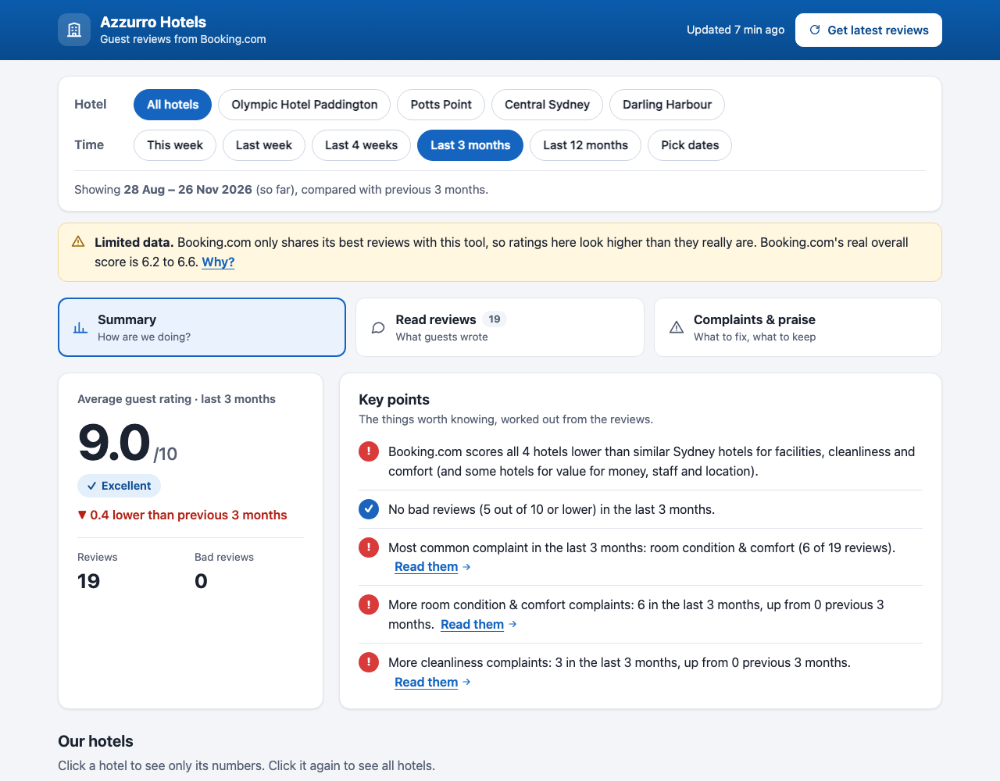
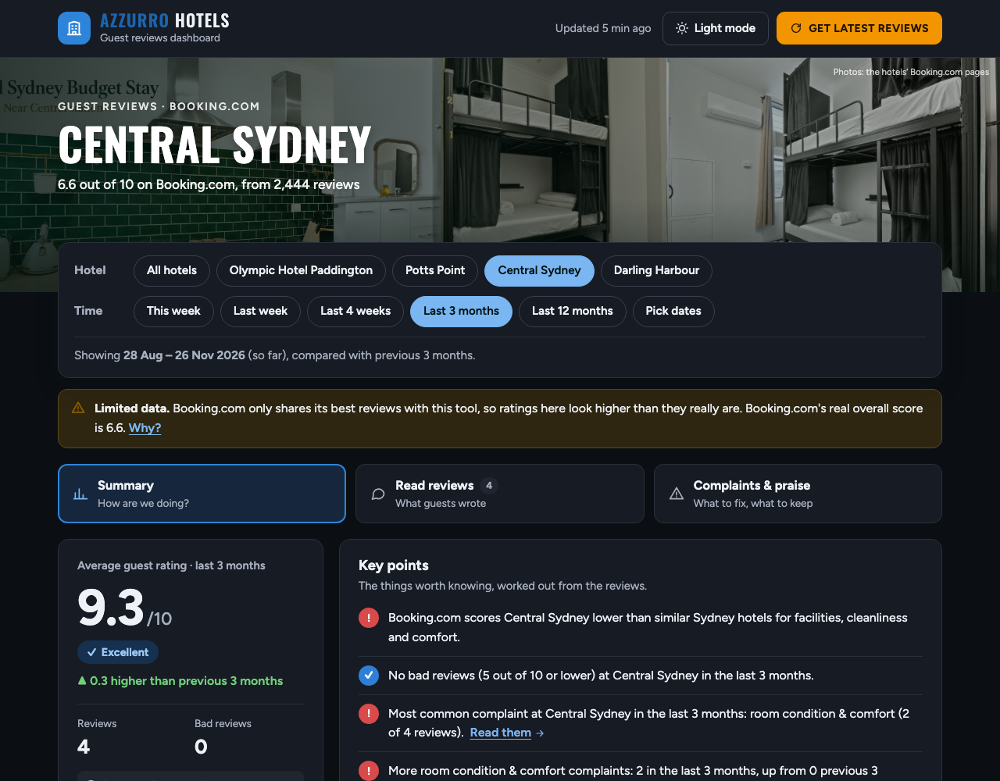
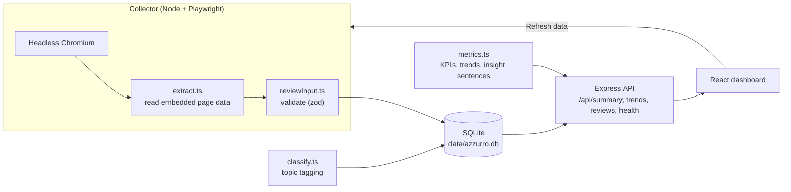
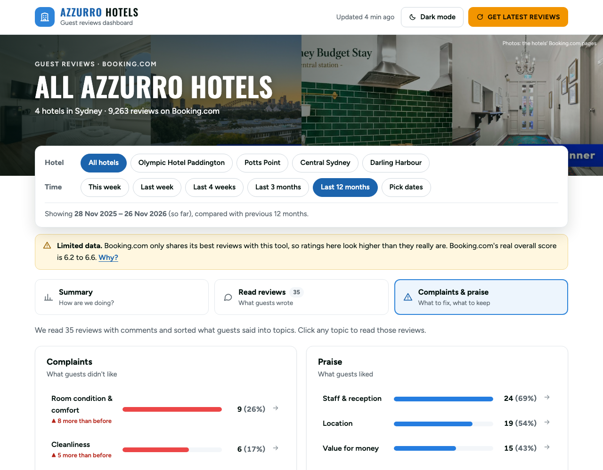

# Azzurro Hotels · Guest Review Insights

Collects public Booking.com guest reviews for four Azzurro Hotels properties and turns them into a dashboard that operations staff can read without help: how ratings moved this week, which property needs attention, and which operational issues (cleanliness, check-in, noise…) guests keep raising.

| Property | Booking.com page |
|---|---|
| Olympic Hotel Paddington | [olympic-paddington](https://www.booking.com/hotel/au/olympic-paddington.html) |
| Potts Point | [venus-potts-point-sydney](https://www.booking.com/hotel/au/venus-potts-point-sydney.html) |
| Central Sydney | [venus-surry-hills](https://www.booking.com/hotel/au/venus-surry-hills.html) |
| Darling Harbour | [chateau-de-venus](https://www.booking.com/hotel/au/chateau-de-venus.html) |



<details><summary>Dark mode</summary>



</details>

The dashboard is built for front-desk and operations staff rather than analysts: one big rating with a plain word ("Very good", "Poor"), short key points, a card per hotel with its photo, "Top complaints" next to "What guests love", and reviews split into *Liked* and *Didn't like*. It is white by default with a **Dark mode** button (the choice is remembered), uses an azure-blue palette (*azzurro* is Italian for sky blue) with an orange **Get latest reviews** button, and shows each hotel's own photos in a banner at the top. Colour is always paired with an icon or a word.

> **Read this first: data coverage.** Booking.com recognises automated browsers and refuses them the full review list. What it does serve is each property's overall score, its category scores (with a benchmark range for similar Sydney properties) and the ~10 reviews it features on each page. Those featured reviews are picked from high scores, so the collected sample (40 reviews) averages about 9/10 while Booking.com's real scores are 6.2–6.6. The dashboard says this on every page and leans on the category scores, which are built from all ~9,300 reviews. See [Known limitations](#known-limitations-and-assumptions) and [Recommended next steps](#recommended-next-steps).

---

## Quick start

Requirements: **Node.js 22.13 or newer** (uses the built-in `node:sqlite`, so there are no native modules to compile). Tested on Node 24.

```bash
npm install
npm run setup        # downloads Playwright's Chromium and loads the sample data
npm start            # builds the dashboard and serves it on http://localhost:8787
```

The sample data (`data/sample/`) means the dashboard works immediately. To fetch live data instead:

```bash
npm run collect      # visits the four Booking.com pages (about 1 minute)
```

If port 8787 is busy: `PORT=8788 npm start`.

### All commands

| Command | What it does |
|---|---|
| `npm start` | Build the dashboard and serve dashboard + API on one port (8787) |
| `npm run dev` | Development: API with reload on 8787, Vite dev server on http://localhost:5173 |
| `npm run collect` | Run the collector (options below) |
| `npm run seed` | Load `data/sample/reviews.json` into the local database (safe to repeat) |
| `npm run export-sample` | Write the database to `data/sample/reviews.json` and `.csv` (guest names removed) |
| `npm run reclassify` | Re-tag every stored review after editing the topic word lists |
| `npm test` | Unit tests (67) |
| `npm run typecheck` | TypeScript check |

### Collector options

```
npm run collect -- [--property <id>] [--featured-only] [--full] [--max-pages n] [--attempts n]

  --property <id>   only this property: olympic-paddington, potts-point, central-sydney, darling-harbour
  --featured-only   read the property page only; skip the full review list attempt
  --full            page through the whole review list instead of stopping at known reviews
  --max-pages n     safety cap on review-list pages per property (default 60)
  --attempts n      attempts per property before giving up (default 3)
```

Exit code is `0` when at least one property was collected and `1` when all failed, so it can be scheduled and alerted on. A run per day is plenty (reviews arrive at roughly 1–8 per property per week). For example, with cron:

```cron
0 6 * * *  cd /path/to/azzuro && npm run collect -- --trigger cron >> data/collect.log 2>&1
```

Staff can also press **Refresh data** in the dashboard, which starts the same collector in the background. A lock file stops two collections from running at once.

---

## Architecture



- **One language, one package.** TypeScript end to end; `src/shared/` (property list, topic taxonomy, date logic, API types) is used by the collector, the server and the browser, so a rule like "a week starts on Monday in Sydney" exists exactly once.
- **SQLite** is enough: four properties produce a few thousand reviews per year. It's a single file, needs no server, and the run log and score history live in the same place.
- **Pure functions for the logic** (`extract.ts`, `classify.ts`, `metrics.ts`) so they can be tested without a browser or database.

```
src/
  assistant/   OpenAI chat agent: agent.ts (Responses API loop), tools.ts (read-only tools), openai.ts (config, errors)
  collector/   browser.ts (Playwright), extract.ts (parsing), run.ts (orchestration, retries, lock), cli.ts
  db/          schema.ts (migrations), repository.ts (upserts, queries, health), reviewInput.ts (validation)
  insights/    classify.ts (topic tagging), metrics.ts (KPIs, trends, insight sentences)
  server/      index.ts (Express API + static dashboard), service.ts (assembles responses)
  shared/      properties.ts, topics.ts (taxonomy), dates.ts (Sydney weeks), types.ts (API contract)
  web/         React dashboard (Vite)
scripts/       seed, export-sample, reclassify
tests/         unit tests + anonymised real Booking.com fixtures
data/sample/   collected sample data (JSON + CSV)
```

### Data model

| Table | Purpose |
|---|---|
| `reviews` | One row per Booking.com review. Primary key is Booking's own review key (`bkg:<reviewUrl>`), so the same review seen in many runs is stored once. Stores score, title, liked/disliked text, language, review date (UTC and Sydney calendar date), stay month, nights, room, traveller type, country, hotel reply, a content hash, and the text-quality flag. |
| `review_topics` | Topic tags per review: topic, `complaint`/`praise`, and the exact words that triggered it. |
| `properties` | The four hotels, Booking.com's hotel id and address, and links to the hotel's gallery photos (`photos_json`). Photos are linked, never copied into the repository. |
| `property_snapshots` | Booking.com's overall score, review count and category scores at every run, so score movement is kept over time. |
| `collection_runs`, `collection_run_items` | Every run, per property: status, attempts, new/updated/rejected counts, full-list outcome and errors. Shown on the *Data status* page (link at the bottom of the dashboard). |

---

## How review collection works

Booking.com has no public review API. What I found while building this:

1. **Plain HTTP requests are blocked.** Property pages sit behind an AWS WAF JavaScript challenge (HTTP 202 + `challenge.js`), and the old `reviewlist.html` endpoint now returns 404. A real browser engine is needed, so the collector uses Playwright's Chromium.
2. **The page embeds structured data.** Each property page carries an Apollo GraphQL cache as JSON (`<script data-capla-store-data="apollo">`). The collector reads that rather than the rendered HTML: Booking's CSS class names are hashed and change between deployments, while the data's entity types (`PropertyReview`, `FeaturedReview`, `BasicPropertyData`) are stable. The lookup is by type, not by fixed path, so moved fields are still found. A visible-text fallback reads the score badge if the data block changes shape.
3. **The full review list is refused to automated browsers.** Clicking *Read all reviews* makes the page call a `ReviewList` GraphQL operation. For the automated browser it answers `ReviewsFrontendError 400 "Request not supported"`, and the page's own data marks the session `isRobot: true`. The collector **does not disguise itself** (no user-agent spoofing or stealth plugins); circumventing bot detection was a line I chose not to cross. Every run still attempts the list, records the outcome, and pages through it newest-first if Booking.com ever serves it.

So each run collects, per property: the overall score and review count, seven category scores with the Sydney benchmark range, and the featured reviews (score, date, title, liked/disliked text, language, traveller type, room, country).

### Reliability and data-quality controls

| Concern | What the collector does |
|---|---|
| Duplicates | Reviews are keyed on Booking's review id; upserts merge rather than insert. A richer copy (e.g. from the full list) fills gaps without being overwritten by a poorer one later. A content hash flags "same text, different id" for review. |
| New and edited reviews | Each run upserts; edits are detected by hash and re-tagged. In full-list mode, paging stops once a page holds only known reviews (`--full` to backfill). |
| Page changes | Structured data first, entity lookup by type, a DOM fallback for the score, warnings when expected parts are missing, and a parser test suite built from a real (anonymised) page. |
| Temporary failures | 3 attempts per property with exponential backoff and jitter; a challenge that doesn't clear and network errors are retried, a changed page structure is not (it won't fix itself). One property failing never stops the others. |
| Diagnosing failures | Screenshot + error saved to `data/debug/`; every run and property outcome is stored and shown in the dashboard. |
| Bad data | Every review is validated before storage (score 1–10, plausible date, known property, sane fields); rejects are counted, not stored. |
| Politeness | One property at a time, 3–6 s pauses between properties and 1.5–3.5 s between list pages; a daily schedule is sufficient. |
| Concurrency | Lock file prevents overlapping runs (cron + dashboard button); runs left "running" by a crash are closed on the next start. |

During development this already caught a real problem: Central Sydney's page streams its data blocks in a different order, so the first block found didn't hold the property. The run log recorded the failure with a screenshot, and the fix (wait for the property's data, not just any block) is in `browser.ts`.

---

## Review insights: method

**Sentiment comes from the guest's score**, not from text analysis: 8–10 positive, 6–7 mixed, 1–5 negative. The guest's own number is more reliable than inferred tone.

**Topics come from keyword rules on Booking's two questions.** Booking asks what the guest *liked* and *disliked*. A topic word found in the disliked answer is a **complaint**, in the liked answer it's **praise**. This sidesteps the biggest weakness of generic sentiment models on hotel reviews ("great location but noisy" is one sentence with two polarities). Eight topics: Cleanliness, Check-in & check-out, Staff & reception, Noise, Facilities & amenities, Location, Room condition & comfort, Value for money. The word lists are in [`src/shared/topics.ts`](src/shared/topics.ts), listed on the *Complaints & praise* page, and hovering a topic label on a review shows the words that triggered it.

Data-quality rules, each based on cases in the real reviews:

- Trivial disliked answers ("Nothing.", "N/A", "All good", "Nothing, all was pretty good") are ignored.
- Short compliments written in the disliked box ("Friendly staff") are counted as praise and marked on the review. The rule is conservative: any complaint, contrast or suggestion word ("loud", "but", "might be better") keeps it a complaint.
- Non-English reviews keep their score but get no tags; reviews with only a score are counted in ratings, not topics.
- Exclusion phrases stop common mix-ups (*light rail* is location, not room lighting; *shared bathrooms* are facilities, not the room).

**Insight sentences** ("50% of negative reviews this week mentioned cleanliness issues (2 of 4 with comments)") always include their counts, and a small-sample warning appears under 5 reviews, so a 100% from one review is never presented as a trend. Comparisons: *this week* vs the whole of last week (Mon–Sun, Sydney time); rolling periods vs the same number of days before.

**Why keywords and not an AI model?** For a first version operations staff can trust, explainability matters most: every tag can be traced to a word, staff can suggest new words, results are deterministic and free to run. The trade-offs are the [limitations](#known-limitations-and-assumptions) below. Classification sits behind one function (`classifyReview`) with a version stamp, so an LLM classifier can be swapped in or run alongside later.



---

## Chat assistant ("Ask a question")

Staff can click **Ask a question** (bottom right) and ask things in their own words, such as "What are guests complaining about at Potts Point this month?" or "Show me recent reviews that mention noise". Answers come from OpenAI, grounded in the same data as the dashboard.

**Turning it on**

```bash
cp .env.example .env      # then put your key in OPENAI_API_KEY=...
npm start                 # restart so the key is picked up
```

`.env` is git-ignored; never commit a key. Without a key the dashboard works as normal and the chat panel says the assistant isn't switched on yet. `OPENAI_MODEL` defaults to `gpt-5.6-terra`; `gpt-5.6-luna` is cheaper. Any model that supports function calling on the Responses API works.

**How it works** (`src/assistant/`)

- Uses OpenAI's **Responses API** with **function calling**. The model can call five **read-only** tools: `get_overview`, `search_reviews`, `get_weekly_trend`, `get_booking_scores` and `get_data_status`. They reuse the dashboard's own queries and metrics, so the chat and the dashboard always agree.
- The model never writes database queries and cannot change data or start a collection. Tool arguments are validated with strict JSON schemas, and bad arguments come back as an error the model can correct.
- The instructions tell it to answer briefly in plain English, always give counts, flag small samples and the featured-reviews limitation, and treat review text as data, not instructions.
- The page sends what the person is looking at (hotel and period), so "this week" and "this hotel" mean what is on screen. The conversation is kept in the browser; the server stores nothing.
- Safeguards: at most 6 model steps per question, the last 12 messages and 2,000 characters per message, and 30 questions per person per 10 minutes. OpenAI errors (bad key, no credit, timeouts) are shown as plain messages.

**Privacy and cost**

- Review text is sent to OpenAI, but guest names are not. OpenAI's API data policies apply.
- A typical question takes 2–3 model calls and roughly 5,000–10,000 input tokens. At `gpt-5.6-terra` list prices that is about 2–3 cents per question.

**Testing:** unit tests cover the tools, the agent loop and the input rules (`tests/assistant.test.ts`). The full path (browser, server, official `openai` SDK) was also exercised against a local stand-in for the Responses endpoint. It has not yet been run against the live OpenAI API, because no key was available during development.

## Known limitations and assumptions

- **Coverage is small and biased (the big one).** Only Booking.com's featured reviews are available to the collector: about 10 per property, <1% of all reviews, chosen from high scores. Ratings computed from them overstate satisfaction, and "negative reviews" will almost never appear. Complaints within them are still real. The dashboard shows a "Limited data" notice on every page and a coverage table on the *Data status* page.
- **Full review list code is untested against a live success.** The paging path and the review-card parser are written against the field names the site's review list uses, are tolerant of missing fields, and are unit-tested with an illustrative response, but Booking.com never returned a successful list during development.
- **Booking.com's terms** restrict automated access. This collector reads public pages at low volume and does not evade bot detection, but before relying on it in production the team should confirm the approach with Booking.com or use an owner-side source (below).
- **Keyword limits:** misses sarcasm, typos and unusual wording, and can tag a word used in another sense (e.g. "after I checked out" tagged as check-in). Every tag shows its trigger words so these are visible.
- **English only** for topic tags.
- **Dates:** the review date is when the guest submitted the review, not when they stayed; weeks are Monday–Sunday in Australia/Sydney.
- **Hotel photos** are shown straight from Booking.com's image server using the links on each hotel's page (the hotels' own photos). They need an internet connection; offline, the banner falls back to plain blue and cards show a hotel icon.
- **Assumptions:** "negative" means a score of 5 or below; property names follow the brief, not Booking's listing titles; guest first names are stored locally (as Booking shows them publicly) but removed from the committed sample.

## Recommended next steps

1. **Use an owner-side source for complete data.** As the property owner, Azzurro has options a scraper doesn't: the Booking.com Extranet's guest review pages, or the review data offered through a channel manager / connectivity partner. The database already has an `import` source type and a single validation contract (`ReviewInput`), so a CSV or API importer is a small addition, and every chart, insight and topic works unchanged with complete data.
2. **Try the assistant with a real OpenAI key** and a handful of typical staff questions before rolling it out.
3. **Alerts:** a message to the duty manager when a review scoring 5 or below arrives, with its complaint topics.
4. **LLM-assisted tagging** for the reviews the keyword rules can't handle (mixed sentences, non-English), checked against a hand-labelled sample before switching.
5. **Hosting:** run the collector daily on a small server and serve the dashboard behind the company's login.

---

## Tests

```bash
npm test
```

67 tests across the classifier (polarity, trivial answers, misplaced praise, overlaps, non-English), Sydney week maths, the page parser (against a real Booking.com page fixture with names replaced, and the real "blocked" response), de-duplication and merge rules, validation, metrics, the insight sentences, and the chat assistant (tool schemas and results, the agent loop against scripted OpenAI responses, history limits).

## Sample data

`data/sample/reviews.json` (re-loadable with `npm run seed`) and `data/sample/reviews.csv` (for a spreadsheet) hold the 40 reviews and 4 property snapshots collected on 26 Nov 2026, with topic tags and guest names removed. No credentials, cookies or keys are used or stored anywhere in the project.
